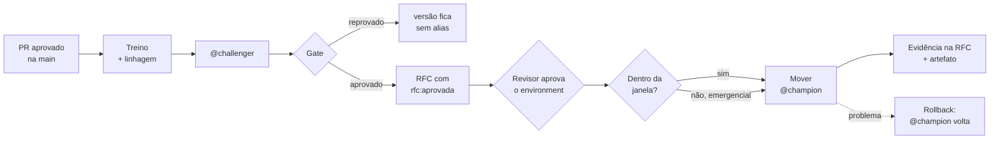

# Governança de modelos com MLflow: mudança de modelo como mudança ITIL


Promover um modelo de machine learning para produção é uma mudança como qualquer release:
precisa de item de configuração, RFC, gate de aprovação, janela e plano de rollback. Este
projeto implementa esse processo de ponta a ponta com **MLflow Model Registry** e **GitHub
Actions**. Nenhum modelo chega a produção sem linhagem, sem aprovação registrada ou fora
da janela, e todo movimento gera evidência auditável.

> Os dados são **sintéticos**, no formato do dataset *Unicorn* (50 startups), gerados por
> `dados/gerar_dados.py`. O foco é o processo de governança, não o modelo.

## O que este projeto demonstra

- **Model Registry como CMDB do modelo**: o modelo registrado é o IC; as versões são
  imutáveis; o alias `@champion` é a baseline de produção; as tags guardam os atributos do
  IC e o registro de cada mudança.
- **Linhagem comprovável**: cada versão aponta para o run, o commit, o pipeline e o dataset
  (com digest) que a geraram.
- **Promoção sem clique manual**: só o pipeline, com uma conta de serviço, move o
  `@champion`, depois do gate automático, da RFC aprovada e da aprovação humana no
  environment.
- **Política como código**: os critérios do gate, a janela de mudança e a matriz de acesso
  são arquivos versionados. Mudar a regra exige pull request.
- **Controle de acesso testado**: um servidor MLflow real com basic-auth é subido no CI, e
  o teste comprova que a cientista de dados **não consegue** mover o `@champion`.

## Gestão de mudança ↔ implementação

| ITIL | Neste repositório |
| --- | --- |
| Item de configuração | Modelo registrado `unicorn-ridge`; atributos em `governanca.yml`, sincronizados pelo treino |
| Baseline de produção | Alias `@champion` |
| Candidato | Alias `@challenger` |
| RFC | Issue com o formulário [RFC — mudança de modelo](.github/ISSUE_TEMPLATE/rfc-modelo.yml) |
| Aprovação do CAB | Rótulo `rfc:aprovada` na issue |
| Gate técnico | `promover.py gate`: linhagem, atributos do IC, LGPD e métrica no holdout fixo |
| Aprovação da implantação | Environment `producao-modelos` com revisor obrigatório |
| Janela de mudança | `janela` em `governanca.yml` (exceção: `--emergencial` com justificativa) |
| Implantação | Workflow **Promoção para produção** |
| Rollback | Workflow **Rollback de produção** (sem janela, de propósito) |
| Registro da mudança | Tags na versão + comentário na RFC + artefato do workflow |
| Revisão de acesso | `config/acessos.yml` aplicado por pipeline a cada merge |

## Fluxo



## Regras implementadas e onde cada uma é testada

| Regra | Onde é aplicada | Teste |
| --- | --- | --- |
| Versão sem commit ou pipeline não passa no gate | `promover.py gate` | `test_gate_reprova_sem_linhagem` |
| Versão abaixo do piso de métrica não passa | `promover.py gate` | `test_gate_reprova_abaixo_do_piso` |
| `dados_pessoais=sim` exige RIPD informado | `promover.py gate` | `test_gate_exige_ripd_quando_ha_dados_pessoais` |
| Só promove versão aprovada no gate | `promover.py promover` | `test_promocao_bloqueada_sem_gate` |
| Gate precisa ter comparado com o champion **atual** | `promover.py promover` | `test_gate_desatualizado_bloqueia_promocao` |
| Quem disparou o treino não aprova a própria mudança | `promover.py promover` | `test_promocao_exige_segregacao` |
| Fora da janela, só com justificativa emergencial | `promover.py promover` | `test_promocao_respeita_janela` |
| Rollback volta para a versão substituída e marca a revertida | `promover.py rollback` | `test_ciclo_completo_promocao_e_rollback` |
| Só a conta de serviço move o `@champion` | servidor MLflow (basic-auth) | `scripts/teste_acesso.sh`, passo 4 |
| A RFC precisa estar aberta e aprovada | `.github/workflows/promocao.yml` | — (regra do workflow) |
| A promoção registra quem aprovou o environment | `.github/workflows/promocao.yml` | — (API de aprovações do GitHub) |

## Rodar localmente em 5 minutos

```bash
python -m venv .venv && source .venv/bin/activate
pip install -r requirements.txt

pytest -q                          # 11 regras de governança
bash scripts/teste_acesso.sh       # ciclo completo contra MLflow com basic-auth
```

O segundo comando sobe um servidor MLflow com autenticação, cria os usuários de
`config/acessos.yml`, treina duas versões, promove, tenta uma promoção indevida, faz
rollback e imprime a evidência. Um exemplo dessa saída está em
[docs/evidencias/exemplo.md](docs/evidencias/exemplo.md).

Para usar a interface do MLflow com PostgreSQL e MinIO:

```bash
docker compose up -d --build       # http://localhost:5000
```

## Rodar no GitHub (fluxo real)

O passo a passo completo está em [docs/configuracao-github.md](docs/configuracao-github.md).
Resumo:

1. Suba o MLflow (`docker compose up -d`) e registre um runner self-hosted na mesma máquina.
2. Rode `bash scripts/configurar_github.sh <owner>/mlflow-governanca`, que cria rótulos,
   proteção da main, environments e segredos.
3. Faça um merge na main: o workflow **Treino e gate** registra a versão como `@challenger`.
4. Abra uma RFC pelo formulário de issue, aplique `rfc:aprovada` e rode
   **Promoção para produção** informando o número da issue.
5. Aprove o environment: o `@champion` muda e a evidência é publicada na RFC.

## Estrutura

```text
governanca.yml               política: gate, janela, atributos do IC, segregação
config/acessos.yml           matriz de acesso ao MLflow (aplicada por pipeline)
config/basic_auth.ini        configuração de autenticação do servidor
src/train.py                 treino com linhagem (commit, pipeline, dataset com digest)
src/promover.py              challenger, gate, promoção e rollback
src/auditar.py               evidência: linhagem + histórico de mudanças
src/permissoes.py            aplica config/acessos.yml (usuários, concessões e papéis)
tests/                       regras de governança como testes
scripts/teste_acesso.sh      ciclo completo contra MLflow com basic-auth
scripts/configurar_github.sh configuração do repositório via gh
.github/workflows/           CI, treino, promoção, rollback, acessos
.github/ISSUE_TEMPLATE/      formulário da RFC
docs/                        RACI, runbook, checklist, alternativas GitLab e Azure
docker-compose.yml           MLflow + PostgreSQL + MinIO
```

## Decisões e limitações

- **Histórico de aliases**: o Model Registry guarda só o estado atual do alias. O histórico
  de cada promoção e rollback é registrado em tags na versão (`substitui_versao`,
  `rollback_em`…), no comentário da RFC e no artefato do workflow.
- **Autenticação**: o basic-auth do MLflow (3.13+, com papéis) resolve a autorização, mas
  guarda usuários e senhas no próprio servidor. Em empresa, o próximo passo é SSO ou uma
  plataforma gerenciada (Unity Catalog, RBAC do Azure ML).
- **Segregação num projeto individual**: com uma só pessoa, quem treina e quem aprova é o
  mesmo usuário. Para demonstrar o fluxo sozinho, desligue `exigir_segregacao` por PR. O
  `gate_politica_sha` gravado em cada versão mostra qual política estava em vigor.
- **Alternativas**: o mesmo fluxo para GitLab CI e Azure Pipelines está em
  [docs/alternativas](docs/alternativas).

## Documentos de processo

- [Matriz RACI](docs/matriz-raci.md)
- [Runbook de rollback](docs/runbook-rollback.md)
- [Checklist da mudança padrão](docs/checklist-mudanca-padrao.md)

## Autor

Valdemir — Gestão de Configuração e Mudança / DevOps, em transição para governança de IA
e MLOps (ITIL + LGPD).
